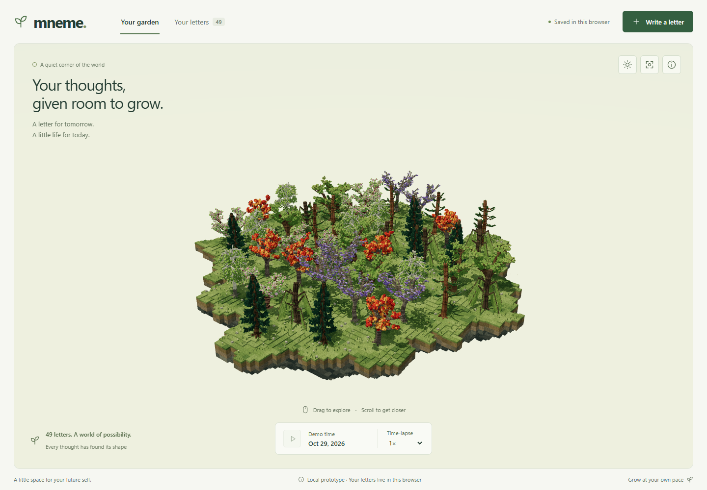

<div align="center">


> **Write a letter. Plant it. Watch it grow.**
> Mneme is a browser-local 3D garden where every letter becomes a seeded voxel tree on a floating island — and only opens on its reveal date.

<br />


</div>

---

## 🌿 Why Mneme?

Some messages shouldn't be read right away.

Mneme turns a future letter — to yourself, or to someone you love — into something living. You write it, pick a reveal date, and a unique tree starts growing from its seed on a shared floating island. Day by day (on Mneme's demo clock) it sprouts, branches, and leafs out. When the reveal date arrives, the tree is mature and the letter finally opens.

No accounts. No cloud. No feed. Just a quiet garden that lives entirely in your browser.

## ✨ Features

- 🌱 **Letters that grow** — Every letter gets one persistent seed and position, growing into an oak, birch, or maple-inspired tree. Wood, twigs, petioles, and leaf blades develop in dependency order — nothing pops in or swaps models.
- 🏝️ **A living island** — Connected terrain extends around permanent tree positions, with textured soil, grass, tapered rock, pebbles, tufts, and flowers. New ground forms *before* a new sprout appears, thickening into one continuous island.
- 🕰️ **One shared demo clock** — A letter planted today reaches its reveal date in ~50 seconds of garden time. Pause, 0.5×, 1×, 2×, and 4× controls are real, and old trees keep their growth when new letters are planted.
- 🌤️ **Atmosphere that follows your day** — Real local time, season, and weather (optional Open-Meteo) drive sky, lighting, rain, snow, pollen, petals, and fireflies — each with independent Auto/manual control and per-effect switches. Manual choices work fully offline.
- 🎵 **Generated nature sounds** — Optional Web Audio soundscapes (breeze, rain, birds, insects) synthesized in-browser. No audio files, no microphone, no external service.
- 🖱️ **Full 3D, fully usable** — Orbit, zoom, and pan on desktop and touch; click/tap a tree or pick it from a keyboard-accessible list; recenter anytime. Letters stay readable even without WebGL.
- 💾 **Private by design** — Everything lives in `localStorage`. Letters are never sent anywhere — weather lookups send only an approximate location or city name, never letter content.
- ♿ **Considerate by default** — Mobile bottom sheets, focus management, inline form errors, draft autosave, and reduced-motion support that quiets particles while keeping lighting and ground cover.

<div align="center">


</div>

## 📸 The Garden

<div align="center">



</div>

> 🎥 Prefer motion? Watch [the growth preview](recordings/mneme-growth.mp4) — a frame-sampled recording of the live 4× simulation. Full check-by-check detail lives in [VERIFICATION.md](VERIFICATION.md).

## 🚀 Quickstart

**Requirements:** Node.js 24

```bash
git clone https://github.com/katniis/mneme.git
cd mneme
npm install
npm run dev
```

Open [http://localhost:3000](http://localhost:3000) — your garden starts empty. Write your first letter and plant it.

**Production build:**

```bash
npm run build
npm start
```

> Stop the dev server before starting production on the same port. Storage belongs to an origin, so `localhost:3000` and `localhost:3001` keep separate gardens.

No environment variables, credentials, API routes, accounts, or backend are required.

## 🌻 How It Works

1. **Write** — A letter (title optional), with formatting preserved. Drafts autosave while you type.
2. **Choose a reveal date** — Must be in the future; validation is inline and friendly.
3. **Plant** — Your letter gets a permanent seed and island position. A tree begins to grow on the shared demo clock.
4. **Watch it grow** — Click or tap the tree anytime to see its dates and growth stage.
5. **Reveal** — At the simulated reveal date, the tree is mature and the original letter opens.

## 🛠️ Tech Stack

| Layer | Technology |
| :--- | :--- |
| Framework | Next.js 16 (App Router) |
| UI | React 19, TypeScript 5.9, CSS Modules |
| 3D | Three.js, React Three Fiber, Drei |
| Audio | Generated Web Audio (no audio files) |
| Weather | Open-Meteo (optional, no API key) |
| Storage | Browser `localStorage` only |

No external fonts or image services are needed — textures and geometry are generated locally.

## 📁 Project Structure

```text
app/          Next.js App Router entry points, layout, global CSS
components/   Garden (interface + persistence), Scene (Three.js world), Tree (growth/removal)
  environment/  Atmosphere controls, weather orchestration, lighting/sky, particles, audio lifecycle
lib/          Deterministic garden/clock, tree/terrain/removal, environment/daylight/particle logic
tests/        Deterministic logic tests (node:test)
screenshots/  Visual evidence
recordings/   Growth preview video
```

| File | Responsibility |
| :--- | :--- |
| [`lib/garden.ts`](lib/garden.ts) | Data schema, storage validation, dates, shared-clock math |
| [`lib/tree.ts`](lib/tree.ts) | Seeded anatomy and dependency-aware growth schedule |
| [`lib/terrain.ts`](lib/terrain.ts) | Permanent placement, topography, materials, connected terrain |
| [`components/Scene.tsx`](components/Scene.tsx) | Instanced geometry, lighting, growth transforms, picking, camera |
| [`components/Garden.tsx`](components/Garden.tsx) | Persistence, simulation, letters, drafts, interface |

Each tree and the terrain each render as a single instanced mesh; stable matrices aren't rewritten every frame, and mature trees stop updating.

## 🔒 Your Data

Only browser local storage is used:

| Key | Stores |
| :--- | :--- |
| `mneme-garden-v1` | Letters, seeds, positions, simulation state |
| `mneme-draft-v1` | The in-progress draft |
| `mneme-environment-v1` | Environment preferences + chosen approximate location |
| `mneme-weather-v1` | Weather cache (cleared when location is cleared) |
| `mneme-audio-v1` | Soundtrack volume only |

**Be aware:** this is a local prototype. Content is not encrypted, the reveal date is a demonstration rather than a secure lock, and clearing browser data deletes the garden. There is no cloud sync or backup. The simulation pauses when the tab is hidden and doesn't catch up to real-world time on reopening.

Location is only requested through an explicit setup action, and only when active effects need it.

## ✅ Checks

```bash
npm test           # deterministic logic tests (node:test)
npm run typecheck  # TypeScript, no emit
npm run build      # production build
```

Tests cover seed determinism, physical attachments, connected terrain, retained land/reuse, clock boundaries, storage validation, time/season/weather resolution and migrations, particle bounds/collision, and deterministic sound profiles.

## ⚠️ Limitations

- Botanical archetypes are constrained, not species-accurate; some crowns overlap in projection as you orbit.
- No LOD system yet for very large gardens.
- Physical mobile hardware, real software-keyboard behavior, screen readers, and long-session GPU performance haven't been tested (desktop + mobile emulation have).
- Wind affects particles and sound rather than deforming tree geometry; audio timbre still awaits human/device listening review.
- If the browser loses a running WebGL context, recovery depends on the browser — reload keeps your saved letters.


## 📄 License

[MIT](LICENSE) © 2026 Justine

<div align="center">


**[Mneme](https://github.com/katniis/mneme)** — a letter for tomorrow, a little life for today.

</div>
